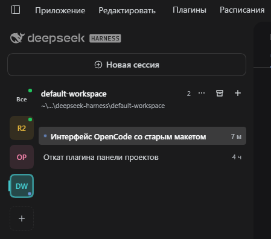

# OpenCode classic sidebar for DeepSeek Harness

`dsh-opencode-classic-sidebar` brings the **classic, pre-redesign OpenCode sidebar
layout** to the DSH Web UI: a narrow column of project tiles on the left, the
selected project's sessions next to it, the global panel buttons in the Windows
caption strip, and an account balance chip.

"Classic" means the OpenCode sidebar as it looked before its redesign — the layout
this bundle reproduces. It is an independent plugin: it copies a layout, not
OpenCode's code, and is not affiliated with the OpenCode project.



Top to bottom in that screenshot: the **Plugins** and **Schedules** buttons in the
window caption strip, the muted brand row, the contour-only **New session** bar,
the **project column** with live markers (All, then one tile per project, then the
**+** tile), the project header with its `~` path and actions, and the **session
list** of the selected project with the open session filled in.

## Install

```
dsh plugin add kuznecov-anatoliy/dsh-opencode-classic-sidebar
```

Restart DSH after installing. Remove it with
`dsh plugin remove dsh-opencode-classic-sidebar`; the shipped workspace browser
comes back.

## What it does

- **Project column** — one tile per workspace (initials, tooltip), the first tile
  **All** lists every non-archived session of every project. Tiles keep a stable
  hue hashed from the workspace id, and are colour-coded against the theme. The
  **+** tile adds a project through the native folder dialog and opens a fresh
  session in it.
- **Session list of the selected project** — title and relative time; pinned
  sessions lead; the session shown in the main view is filled in.
- **Markers** — a ring on the tile that holds the session open in the main view, a
  blue pulse while a session of that project runs, a faster red pulse when a
  session waits for your answer (approval or question), a green dot for a
  finished session you have not looked at yet. Only project tiles carry a dot:
  the **All** tile is a filter over every project, so it stays bare and keeps the
  summed hints in its tooltip.
- **Session actions** — the **…** button on a hovered row or a right click opens
  the row menu: pin/unpin, rename, fork, copy id, archive. Archived sessions are
  restored from the archive view, not deleted.
- **Project actions** — right click on a tile or the **…** in the project header:
  rename, or delete the workspace from the registry (the folder on disk is kept).
- **Archive view** — a toggle in the project header lists archived sessions of
  every project, each with a restore action.
- **Panel buttons** — on Windows the Plugins and Schedules buttons move from the
  sidebar navigation list into the caption strip beside the application menu;
  the navigation list is hidden there. On other platforms the shipped list stays.
- **Balance chip** — remaining balance, plus spent today and in total, above the
  settings row. Click opens the top-up page, Shift+click forces a refresh. The
  numbers come from the signed-in DeepSeek account, or from `DEEPSEEK_API_KEY`
  when there is no account.

## Layout and limits

- The bundle occupies the single `sidebar.workspaces` slot with `priority: -1`,
  which shadows the shipped workspace browser at priority 0. The region is
  therefore owned by this bundle: search, drag ordering and multi-select from the
  shipped browser are not reimplemented, and the **All** tile keeps every session
  reachable without the shipped search.
- Sessions are archived, never deleted — the harness API has no session delete.
- Renaming a session goes through a small Host route
  (`POST /api/dsh-opencode-classic-sidebar/session-rename`) that calls
  `sessionController.rename`, because the shipped rename dialog belongs to the
  browser this bundle replaces. If that internal service is unavailable the
  action reports a failure instead of pretending to succeed.
- The brand row and the New-session bar are restyled through the documented
  `[data-slot="..."]` anchors of the sidebar, not through the shipped
  CSS-module hashes. A future sidebar redesign can drop that cosmetic override;
  it cannot break the list itself.
- Requires DeepSeek Harness `>=0.2.2-rc.1 <0.3.0`.

## Development

`node harness.cjs` loads `client.js` in Node with a fake React renderer and fake
Client services, then exercises the whole flow: creating a project through the
folder dialog, the session and project menus, the archive view, the rename route,
the caption-strip panel buttons and the injected stylesheet.

## License

MIT
