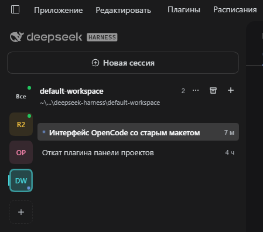

# OpenCode classic sidebar

`dsh-opencode-classic-sidebar` reproduces the classic (pre-redesign) OpenCode
sidebar layout inside the DSH Web UI. It ships two halves:

- `client.js` — a static Client module. It registers three slots:
  `sidebar.workspaces` (the project column and session list),
  `sidebar.footer.action` (the balance chip) and, on Windows only,
  `shell.overlay` (the panel buttons in the caption strip).
- `index.js` — a Host plugin that serves the balance route and the session
  rename route over `connection.fetch`.

```yaml
- insert:
    - id: opencode-classic-sidebar
      name: dsh-opencode-classic-sidebar
```

"Classic" is the layout only: the project column, the session list beside it and
the panel buttons in the window strip. No OpenCode code is used, and this bundle
is not affiliated with the OpenCode project.



## How the region is taken over

The shipped `WorkspaceBrowser` occupies the single `sidebar.workspaces` slot at
priority 0. SlotCore sorts a cell's entries by priority ascending and the outlet
renders the first one, so this bundle registers at priority -1 and becomes the
active occupant. Data comes from the slot's own standard props
(`useWorkspaces`, `useSessions`, `useSessionStatus`, `useSessionRetainInfo`),
and every mutation goes through public Client services:

- `uiWorkspace.openSession`, `startSession`, `forkSession`, `pinSession`,
  `unpinSession`, `archiveSession`, `unarchiveSession`, `pickDirectory`;
- `workspaces.create`, `rename`, `delete`;
- `layout.selectPanel` for the panel buttons.

The one exception is session rename: there is no Client service for it, because
the shipped dialog lives inside the replaced browser. The Host half exposes
`POST /api/dsh-opencode-classic-sidebar/session-rename` with
`{ sessionId, title }` and calls `ctx.get('sessionController').rename(...)`. A
missing service answers 503 and the Client shows a failure notice.

## What the sidebar carries

- **Project column** — tiles with initials, a tooltip and a stable per-project
  hue (`TILE_TONES` palette, hashed from `workspaceId`; light values on `:root`,
  dark values on `body[data-ds-dark-theme]`). The first tile is neutral **All**
  (every non-archived session), the last one is the **+** add-project tile.
  Clicking a tile opens the newest session of that project.
- **Session list** — rows with title and relative time. The **…** button appears
  on hover in place of the time, and right click opens the same menu: pin/unpin,
  rename, fork, copy id, archive; archived rows get restore instead. Pinned
  sessions sort first, in Host order.
- **Markers** — `retainedBy.mainView > 0` rings the tile of the project holding
  the open session; running sessions pulse blue, sessions waiting for an answer
  pulse red faster, `completionUnread` shows a green dot. One marker per tile by
  priority red → blue → green. `prefers-reduced-motion` is honoured.
- **Project header** — project title, session count, the project **…** menu, the
  archive toggle, a new-chat button and the shortened `~` path of the workspace
  (full path in the tooltip).
- **Archive view** — archived sessions of every project, with restore.
- **Balance chip** — reads `/api/dsh-opencode-classic-sidebar/balance` (GET) and
  `/balance/refresh` (POST), caches a reading for 30 s, polls every 60 s and on
  window focus, and keeps the day's spend baseline under
  `DSH_HOME/dsh-opencode-classic-sidebar/day-spend.json` (falling back to the
  earlier `dsh-projects-rail` and `dsh-rail` files once, so an existing history
  survives).
- **Panel buttons (Windows only)** — the Plugins and Schedules buttons render in
  the caption strip next to `[data-windows-menu]`, and the shipped navigation
  list is hidden by a rule scoped to `html[data-windows-titlebar]`, so other
  platforms keep it.

## Styling notes

The bundle inherits theme tokens (`--dsw-alias-*`, `--dsw-specific-sidebar-fill`)
and ships one `<style>` element per plugin effect. The shipped sidebar brand row
and New-session bar are tuned through their documented `[data-slot="..."]`
anchors — `sidebar.brand.mark`, `sidebar.brand.name`, `sidebar.session.action` —
because their CSS-module class names are build hashes. Only that decorative
override can be lost by a sidebar redesign; the list itself uses its own classes.

## Limits

- Search, drag ordering and multi-select are not implemented; **All** covers the
  reachability the shipped search provided.
- Sessions cannot be deleted: the harness API exposes archive/unarchive only.
- The rename route depends on an internal Host service (`sessionController`);
  a future release can move or rename it, and the action then reports failure.
- `engines.dsh` is `>=0.2.2-rc.1 <0.3.0`, matching the release this bundle was
  built and verified against.

## Verification

`node harness.cjs` builds the module in Node with a fake React hook engine, fake
host globals, fake Client services and fixture workspaces/sessions, then asserts
the flows above (project creation through the picker, session and project menus,
the archive view, the rename request body, the injected stylesheet and the
caption-strip buttons). It prints `harness OK` plus a JSON summary.
